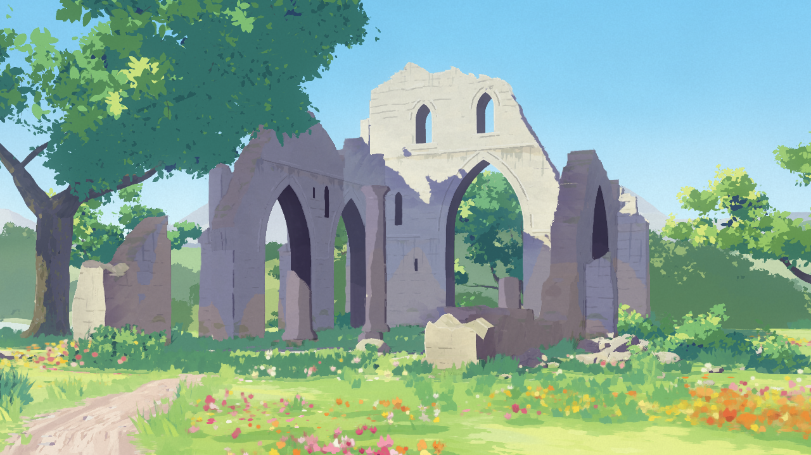

# anime-3d2d

Real-time 3D that reads as a 2D anime background painting — a ruined abbey in four states (day/evening, summer/winter).



**Live:** https://an-visuals.cinne.dev

## Run

```sh
npm ci
npm run dev   # Node 22.18+
```

`N` toggles day/evening, `M` summer/winter, `P` painter's licence. Deploy with `npm run deploy` (Cloudflare Workers).
